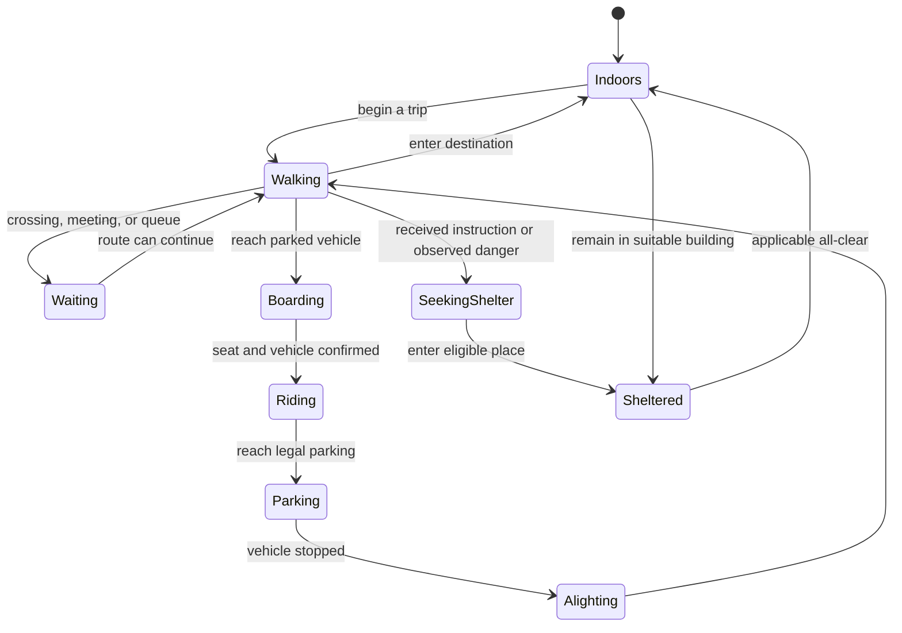

# Ohio State campus upgrade: research and build specification

**Date:** 24 October 2026  
**Status:** Research and character exploration complete; application implementation has not started in this pass.  
**Direction:** A recognizable Columbus campus diorama with legible people, coherent daily lives, real transport state, and educational hazard scenarios.

This specification consolidates three parallel research investigations, direct inspection of the current code, three generated character boards, and a bounded real-world map-data feasibility check. It replaces “make the sprites larger and add weather particles” with a staged change to geography, behavior, presentation, and validation. It does not claim the current game is a calibrated model of Ohio State.

## 1. Decisions

| Area | Decision | Why |
|---|---|---|
| Character direction | **C / Living Diorama**, with B's everyday clothing variety | C has the most suitable oblique top-down camera, compact silhouettes, and directional studies. B is useful for costume/portrait references. |
| First scene | Oval → Thompson Library → Mirror Lake → High Street/Ohio Union | Recognizable geography, mixed indoor/outdoor destinations, pedestrians, social spaces, and a real road edge within one focused view. |
| Expanded map | Lane Avenue to 11th Avenue; Olentangy corridor to Indianola Avenue | Adds residence areas, stadium/RPAC, river crossings, and an off-campus neighborhood edge without attempting all Columbus. These are proposed game bounds. |
| World representation | Versioned, georeferenced vector geometry and separate movement networks | The existing shared 40×40 cardinal graph cannot represent real distances, public paths, parking, and legal driving accurately. |
| People | Persistent synthetic identities, variable households, groups, goals, and activities | Role and clothing alone do not produce believable behavior. |
| Emergencies | Hazard-specific protection and legal actions | Staying in a suitable building can be success; universal evacuation is wrong for several requested hazards. |
| Stack | Keep React/TypeScript, PixiJS 8, Python/Mesa/NetworkX, existing Bedrock and Mini integration | The missing pieces are assets, world contracts, and behavior—not a reason to migrate the application to another engine. |
| Accuracy | Label observed, derived, and authored parameters | Real geography and weather evidence do not establish measured individual behavior. |

Read the [character options](research/campus-concepts/README.md), [campus evidence](research/osu-campus-geography.md), [people research](research/campus-people-art-and-behavior.md), and [hazard evidence](research/columbus-hazards-evidence.md). The [map feasibility bundle](research/campus-data/README.md) is research input, not an imported production map.

## 2. Why people currently disappear

The atlas generator supplies **12×20-pixel frames**, mostly the same anatomy with palette/hat changes. The organic renderer scales these by 1.35; the mobile default camera multiplies them by 0.625. The entire 20-pixel frame therefore occupies only **16.875 CSS pixels** before considering transparent padding. The visible body is smaller. Whole-map overview shrinks it further.

Several residents also share an exact node center, hiding one another. Walking animation advances by a time-based cycle rather than traveled distance. Indoor people correctly disappear from the exterior, but the game does not replace that disappearance with enough discoverable building activity. More detailed textures alone will not solve these issues.

### Readability contract

- Start production with a **32×48 frame envelope** and a consistent foot anchor; compact bodies can occupy about 32×40 inside it.
- Target **28–36 CSS pixels of visible body height** at normal neighborhood zoom. These are design targets to validate, not established perceptual thresholds.
- Provide three useful views: campus overview, neighborhood play, and person follow. Person follow should support a 48–64 CSS-pixel character for close inspection; this is also a proposed target. Overview shows truthful occupancy/density markers and named places; neighborhood view is the default for observing people.
- Keep a selected person's face, clothing, direction, and nearby group legible. Use a small selection ring and portrait, not a permanently enlarged crowd.
- Use quiet ground textures, strong silhouette edges, and separated light/dark clothing values. Preserve legibility at dusk and against snow.
- Give people recorded positions within walkable space. Avoid arbitrary visual offsets that put a walker in a road, lake, wall, or another person.
- Keep accessible React inspector/list alternatives for canvas selection. Weather-effect/particle intensity and reduced-motion settings affect presentation only; physical wind, hail, and visibility remain scenario parameters.
- Keep pixel-art numerals with clear, distinct 2/5 glyphs and equal digit widths. The current HUD uses original pixel digits alongside Pixelify lettering; do not replace game readouts with plain monospace.

### Production art workflow

The three boards contain **36 principal concept studies across three directions**. They are not valid animation atlases. Their requested logical pixel sizes were artistic instructions, not verified output dimensions.

Build six in-engine seed characters first: backpack student, hoodie student, professor, campus worker, parent/child pair, and wheelchair-using student. Test them on actual ground backgrounds at desktop and mobile sizes. Normalize perspective, palette, transparency, body size, and feet before expanding the collection.

Use whole-strip animation production from a verified seed, shared scaling, and a common bottom-center anchor. The [OpenAI sprite-pipeline reference](https://raw.githubusercontent.com/openai/plugins/main/plugins/game-studio/skills/sprite-pipeline/SKILL.md) provides a suitable normalization workflow. Four directional walk cycles are enough for the first proof; add diagonals and additional actions after the movement pipeline is sound.

Required observable actions: idle, walk, turn, greet, brief conversation, phone check, sit, wait, enter/exit a building, board/alight. Clothing and accessories must stay attached across frames. Walking phase follows recorded distance; feet cannot keep walking while a person waits. Avoid mass production until the six-character proof passes.

Generated concepts and [exact prompts](research/campus-concepts/prompts.md) are saved locally. Built-in image generation was used; no paid third-party art subscription is required.

## 3. A recognizable campus, with an honest geographic foundation

The public [OSU tour map](https://campusvisit.osu.edu/media/kpwoxu0v/self-guided.pdf) establishes the key relationships: Thompson west of the Oval, Mirror Lake to its south, the Union on the High Street side, and the stadium northwest with RPAC nearby. Preserve these relationships and distinctive silhouettes before adding decorative density.

The art should use broad lawns, diagonal paths, campus brick/stone buildings, larger residence buildings, bus stops, crosswalks, gardens, and the commercial street edge. The academic core should not resemble rows of detached village cottages. Use original building art rather than copied map tiles, logos, or game assets.

### Data pipeline

1. Pin a bounded OSM vector snapshot, retain source IDs/tags, timestamp, hash, extent, and [ODbL attribution](https://www.openstreetmap.org/copyright).
2. Transform latitude/longitude into a documented metric coordinate system; derive distances from geometry.
3. Build separate pedestrian, vehicle, and transit networks. Split at valid connections; preserve bridges, layers, access restrictions, steps, crossings, and directionality.
4. Add public entrance connectors, parking-transfer points, and authored activity/shelter metadata as a separate reviewed overlay.
5. Keep source geometry, artistic simplification, and behavioral assumptions distinguishable.
6. Package the snapshot locally. No runtime dependence on public map tiles or repeated Overpass queries.

The bounded research extract contains **2,496 geographic features, including 117 building features**, for an approximately **922×666 m selection**. Complete selected ways extend beyond that box; clipping and boundary portals remain design work. The extract proves public vector acquisition is feasible. It does **not** prove every road is legal to drive, every path is public, every building is open, or every route is accessible. Sparse access/wheelchair tags require explicit unknown states and review. Do not infer an accessible route simply from graph connectivity.

City building layers are an optional cross-check only until their redistribution terms are resolved. CABS and COTA remain distinct. CABS public schedules support a campus bus fixture; no public CABS GTFS was verified. COTA provides GTFS under its own terms. Do not imply a generated bus timetable is measured live service.

### Versioning

Add a new campus world/version rather than changing old Riverside coordinates. Save the source-map hash, movement-network version, behavior configuration, weather fixture, and art version with each recording. Legacy runs must continue replaying their original geometry and decisions.

## 4. People who have a life before an alert

Use synthetic people and aggregate constraints. No real student records, personal schedules, directory data, or actual occupants.

| Person/group | Everyday activity chain | What makes it visible |
|---|---|---|
| Residence-hall student | Dorm → dining → class → library → recreation → dorm | Backpack, class-change departures, friends waiting outside, indoor occupancy |
| Off-campus student/roommates | Shared home → campus → café → study → home | Shared departures on some trips, separate commitments on others, later reunion |
| Professor/graduate researcher | Off-map/home → parking or bus → office/lab → class → lunch → return | Parking transfer, carried books/bag, flexible gaps rather than continuous office occupancy |
| Campus/service employee | Arrival → shift destination → break → errands → return | Different shift windows and destinations, not a universal 9-to-5 schedule |
| Neighborhood household | Home → errands → walk/park → home | Household relationships, variable pace, shared trip planning |
| Visiting family | Arrival/parking → campus walk → meeting/food → return | Parent/dependent cohesion and actual shared vehicle seats |

These chains are plausible authored templates until supported by appropriate observations. Institutional enrollment is not simultaneous map occupancy; Census commuting-to-work tables are not student class-trip counts. The [campus memo](research/osu-campus-geography.md) documents applicable aggregate sources and their limits.

### Behavior architecture

Each person needs a stable ID, appearance ID, household/social group, home/entry portal, role, schedule windows, goal queue, current activity, mobility/access requirements, transport access, and memory of delivered information.

Use activity windows and individual variation rather than synchronized fixed departures. Groups maintain shared intentions and rendezvous, but individuals keep their own positions and activities. Friends may slow to converse, wait at a crossing, meet outside a destination, or separate for different classes. A family is a relationship and coordination model—not several similar sprites moving together by coincidence.

Social behavior must allow assistance, affiliation, and checking on others. Avoid treating every emergency as automatic selfish panic. Source evidence supports mechanisms to consider; it does not supply universal OSU response percentages.

### Real mode transitions

Vehicles have their own IDs, driver, occupants, seats, parking location, permitted graph, and trip. A person cannot appear simultaneously as a pedestrian and passenger. Cars cannot drive across the Oval or disappear when someone alights. A bus has stop order, capacity, and an actual waiting/boarding queue.

Use meters and seconds for travel; record continuous edge progress and significant events. Playback acceleration is separate from physical speed. Coarse daily frames can be compressed for storage, but must not imply that every walk takes an arbitrary number of five-minute steps.

For emergency reunification, contact/holding can be the available choice. A family goal never overrides a closed edge or directs a dependent into the dangerous area.

### Bedrock and local responsibilities

Bedrock supplies actual high-level intentions at bounded decision points, using the person's goals, relationships, known information, present location/mode, and legal options. Local simulation handles navigation, avoidance, crossings, vehicle seats, boarding, timing, and collision constraints. Rendering interpolates those recorded states.

This preserves real LLM decisions without paying for movement every frame or letting an LLM invent safe coordinates. Routine plans can be authored/cached initially; the UI and methods must distinguish them from real model decisions. Extend and version the decision protocol rather than reinterpreting existing `WAIT` as sheltering.

Retain fail-visible provider behavior, saved decision provenance, and spending reservations. TRIBE Mini stays an independent warning-text model output; it is not a measured fear/compliance variable.

## 5. Four new hazards with different lessons

| Scenario | Experience and protective behavior | Evidence and calibration boundary |
|---|---|---|
| **Blizzard** | Blowing snow, low visibility, altered road conditions, postponed trips, people staying indoors, recovery over a multi-hour clock | Local definition combines ≥35 mph sustained/frequent gusts, falling/blowing snow, visibility ≤¼ mile, and ≥3 hours. Snow depth alone is insufficient. [Wilmington criteria](https://www.weather.gov/iln/criteria-winter) |
| **Hailstorm** | Visible hail and shelter-seeking; outside gatherings stop; cars/buildings have separate exposure state | Hail diameter is a physical parameter. Hail belongs to severe-thunderstorm warning products; do not invent an official “Hailstorm Warning.” Damage curves remain authored until validated. |
| **Destructive thunderstorm** | The requested very severe storm: wind, rain, hail/lightning, interruptions, and nearby indoor shelter | NWS destructive damage-threat criteria are ≥80 mph wind or ≥2.75-inch hail. It is not a guaranteed damage level at every location. [NWS categories](https://www.weather.gov/lot/SevereThunderstormWarningsUpdate) |
| **Major Public Safety Threat** | A fictional designated dangerous area, avoidance perimeter, current instructions, closed routes, updates, and explicit all-clear | Keep the cause unspecified. No attacker or weapon entities, school-shooting/terrorism content, incident reenactment, or invented crime statistics. Geometry/timing are authored scenario assumptions. |

Indoor occupancy must affect protection, not merely hide a sprite at a dangerous doorway. Apply this correction to newly generated tornado/flood/fire runs too: use hazard-appropriate destinations and protection, prevent flooded-route travel, and never treat an affected burning building as safe shelter. Preserve old recordings as historical replay rather than silently changing their outcomes. The existing outdoor-fire model is not a verified building-fire model. Shelter suitability varies by hazard; a building is not universally safe from flood or fire. Real campus landmarks must not be presented as verified emergency shelters or capacities without evidence.

Thunderstorms need a last-thunder hold timer: the NWS guidance is to remain sheltered at least 30 minutes after the last thunder. A visual lull must not release everyone early. This timer uses authoritative simulation time, never an audio clip or the rendering clock. [NWS lightning guidance](https://www.weather.gov/safety/lightning-tips)

Record `SEEK_INDOOR_SHELTER`, `SHELTER_IN_PLACE`, `POSTPONE_TRAVEL`, and appropriate route/area actions separately. `ALL_CLEAR` is a scenario-authority event, not a resident LLM's assurance. Show “in suitable shelter,” “still exposed,” “travel interrupted,” and “needs assistance”; a universal “evacuated” score would teach the wrong objective.

## 6. Evidence and accuracy

Each meaningful parameter gets provenance:

- **Observed:** a timestamped weather observation or reported hail size at a stated location.
- **Derived:** a map distance, unit conversion, or documented interpolation.
- **Authored:** warning receipt, trust, response delay, occupancy, capacity, social coordination, closure probability, or an unspecified incident perimeter.

Candidate local cases are the June 2012 Ohio derecho and December 2022 winter storm. NWS narratives and reports support educational context. They do not establish exact campus conditions. The [hazard memo](research/columbus-hazards-evidence.md) distinguishes Franklin County reports, forecast-zone winter records, airport observations, publication lag, and missing data.

A bounded [NOAA data sample](research/weather-data/README.md) is now saved: **141 KCMH weather reports for December 22–24, 2022**, with the station mapping verified, raw and filtered CSV, timestamps, exact request, and hashes. They are mixed report types, not 141 uniform hourly observations. Compound quality fields and repeated CSV headers still need careful decoding. These airport reports are not campus measurements.

Next data work: decode and quality-control that sample, build documented weather curves, and ingest selected NCEI event records with IDs and time zones. Preserve gaps and quality flags. Use complete episodes for validation holdouts. Do not infer zero occurrence from absent reports or fit human compliance from meteorological records.

Use separate validation tracks:
1. **Software correctness:** legal routes, conserved occupants, time units, replay integrity.
2. **Geographic/physical validity:** sourced geometry, measured distances, documented weather values.
3. **Behavioral validity:** justified assumptions and sensitivity ranges; independent behavioral observations are still needed.

The [NIST evacuation-model verification/validation framework](https://www.nist.gov/publications/process-verification-and-validation-building-fire-evacuation-models) is useful for decomposing movement, route availability, response time, and flow constraints. Its building-fire context is not automatic validation for campus weather.

Warning comparisons also need an experimental-design fix: current presets vary delivery assumptions as well as text. A wording-only comparison must keep delivery reach, channels, timing, population, physical scenario, and model settings identical. Separate “message wording” from “communication strategy” experiments. Repeat across seeds/model generations and report uncertainty rather than one definitive winner.

## 7. A game people can understand

Keep one simulator workspace.

- **Top:** place, clock, weather, play/pause/speed; clean readable numbers.
- **Bottom:** compact hazard palette, warning composer, Run, Advanced.
- **Map:** default neighborhood camera, named anchors, subtle occupancy, minimap/overview, optional paths/closures.
- **Person inspector:** portrait, role, present activity, destination, household/friends, current travel mode, received message, and recorded decision.
- **Building/vehicle inspector:** actual occupants, capacity assumption, suitability, current status.
- **Debrief:** what happened, why outcomes differed, interrupted trips, unresolved needs, and the relevant safety lesson.
- **Advanced:** source/provenance, model settings, exact assumptions, uncertainty, saved runs, and Mini results.

Use short scenario objectives: warn before a class-change rush; keep a household sheltered through a storm lull; avoid unnecessary winter travel; reroute around an unspecified restricted area. Reward good communication and correct protective action. Do not gamify casualty totals or imply the game is a live alert service. Mark every authored alert card clearly as “Simulation” so an isolated screenshot cannot be mistaken for an official campus alert.

## 8. Tools and skills

No engine rewrite or new hosting provider is needed.

| Tool/workflow | Proposed role | Verification |
|---|---|---|
| Existing PixiJS 8 + TypeScript | Sprite rendering, camera levels, depth ordering, chunked static scenery | [Official PixiJS skills](https://github.com/pixijs/pixijs-skills) reviewed; MIT, 357 stars observed on research date; install count not verified. Sprite skill read directly. |
| Pixelorama | Free editable pixel-source files, animation cleanup, palette control, atlas exports | [Official project](https://pixelorama.org/) checked. |
| Tiled | Authored scenery/activity overlays and editable object metadata over canonical geography | [Official project](https://www.mapeditor.org/) checked. It does not replace a valid GIS/routing import. |
| OpenAI sprite-pipeline reference + installed imagegen skill | Seed → complete strip → normalize → inspect in engine | Primary skill source read; current boards generated with built-in tool. |
| Python/Mesa/NetworkX + a reviewed geometry importer | Authoritative people, groups, paths, vehicle state, weather | Reuse current local service and recordings; add metric map contracts. |
| Bedrock + current budget ledger | Sparse, contextual resident intentions | Preserve current service and explicit costs; no paid call per frame. |

Only reference material was reviewed; no third-party plugin executables were installed. Installation counts for the official Pixi skill could not be verified and are not invented. Tool adoption must be tied to a concrete need. A paid art editor is optional, not a dependency.

## 9. Build sequence and acceptance gates

Do not batch-generate hundreds of assets or expand the entire map before a focused scene proves the result.

| Milestone | Deliverable | Must pass before advancing |
|---|---|---|
| **1. People art proof** | Six representative characters on current engine backgrounds, idle/walk/turn, normal camera | Readable at desktop and 390/320-pixel mobile widths; no feet sliding, blur, scale drift, or crowd hiding; pause/seek correct |
| **2. Campus geography slice** | Oval–Thompson–Mirror Lake–High Street from pinned geometry, original landmark art | Correct relative landmarks, visible paths, no lawn driving, bridge/layer correctness; source/licensing manifest; representative walking-distance checks |
| **3. Daily life and cars** | Variable households, role-specific goals, social meetings, real walking/boarding/parking/alighting | No teleports or duplicated people; conserved seats/occupancy; reproducible trips; groups can wait/reunite; real destinations and missing-route states |
| **4. Indoor protection and severe storm** | Versioned actions, suitable indoor places, corrected existing-hazard protection, destructive-thunderstorm fields, lightning hold | Inside/outside exposure differs correctly; threshold/timer tests; no unsafe default universal evacuation; Bedrock actions validated |
| **5. Hail and blizzard** | Separate hazard parameters, winter travel changes, multi-hour scenario | Blizzard conjunction/duration correct; missing observations cannot silently satisfy duration; no shortened-event mislabel; weather overlays never make people unselectable |
| **6. Generic safety threat** | Authored avoidance area, updated messages, legal rerouting, explicit all-clear | Cause remains vague; no invented incident data; no closed-zone shortcut; recorded message version controls response |
| **7. Learning and evidence** | Source cards, historical fixtures, fair warning comparison, meaningful debrief | Observed/derived/authored clear; no unsupported injury probabilities; Mini separated from behavior; exact fixture/version replay |
| **8. Full demo** | Both warning variants, saved replay, returning to daily life, all hazards | Backend tests, browser flow, old recordings, performance, reduced motion, budget accounting, mobile layout |

Start the slice with 24–48 actors to expose defects, then benchmark the existing 300-person scale; a higher population is an earned performance target. Record render/update time, memory, visible population, and device/browser. A high display-refresh rate is not by itself a rendering benchmark.

Main regression tests should exercise behavior, not mirror implementation: correct graph traversal, groups and seats conserved, blocked-route handling, indoor state, hazard threshold edges, safe hold duration, replay at different speeds, unchanged historical runs, and provider-failure behavior.

No destructive database migration is proposed for the research phase. Future versioned schema/storage changes must retain existing recordings and be reviewed before application.

## 10. Budget and delivery boundaries

Research and map acquisition in this pass made **no AWS inference calls**. Preserve the existing $30 project ceiling and current per-run/phase guards. The local ledger is an estimate/reservation record, not an independently verified AWS bill.

Use mocks and deterministic local checks for development. Real Bedrock verification should be a small bounded final check after the local contracts pass. Local Mini output is reused only when its warning hash and provenance match.

What is finished now: researched decisions, source-linked specialist memos, 36 character concept studies, prompt provenance, real map and weather feasibility artifacts, and an independent hazard review of this plan. What remains application work: normalized sprites, campus import/rendering, multimodal behavior, new hazard mechanics, historical calibration, and the full integrated QA sequence above.

