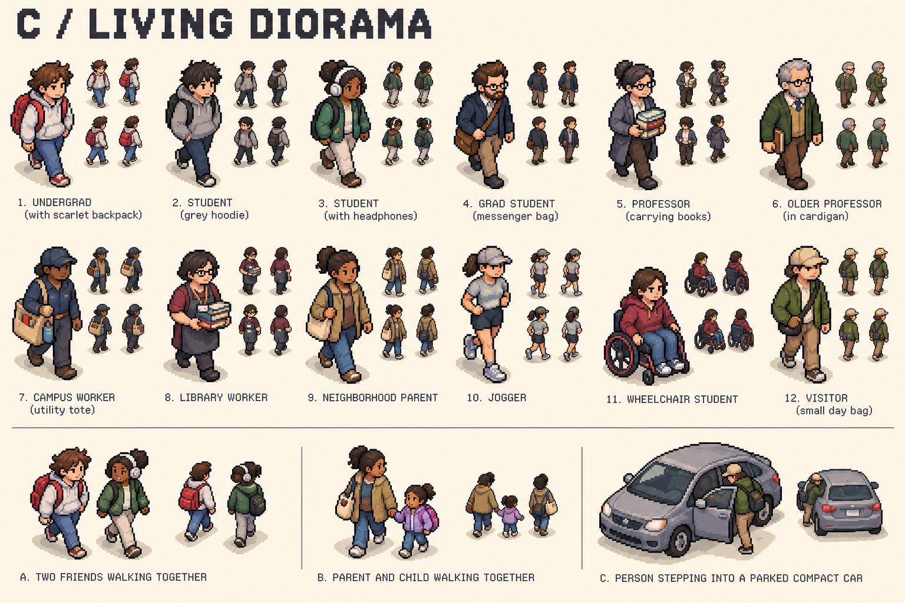
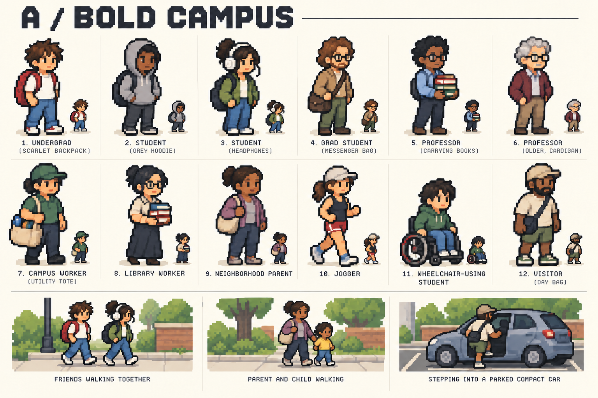
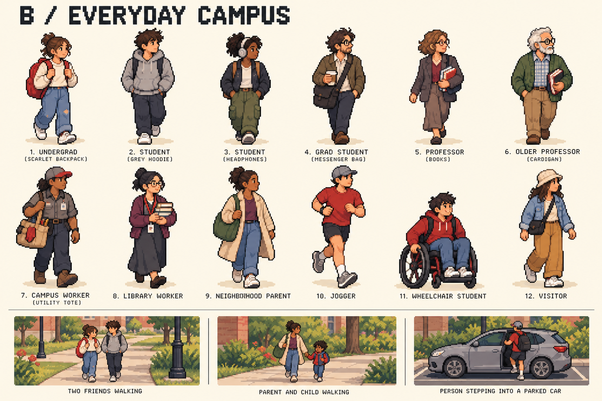

# Campus character options

Created 2026-10-24 with the built-in image-generation tool. These are **art-direction concepts**, not imported game assets, normalized sprite sheets, or screenshots of an implemented campus.

## Recommended direction: C / Living Diorama

C has the strongest match for an oblique top-down world: visible top planes, compact silhouettes, readable bags, and multiple directional studies. Use its camera and proportions, borrowing the everyday clothing variety from B. Preserve distinct skin tones, hair, bodies, ages, and mobility aids without tying appearance to decision quality.

Production target: a consistent 32×48 frame envelope (some compact bodies occupy roughly 32×40), a shared foot anchor, and a 28–36 CSS-pixel visible character height in the default neighborhood view. This is a proposed target to validate in the engine, not a property proven by these boards. Larger portraits can retain details that disappear at play scale.

## A / Bold Campus

The strongest exaggerated outline and compact proportions. Useful if readability wins over natural anatomy. The revised board removes an uncalibrated scale caption from the initial generation. Use the production test below to establish actual screen size.

## B / Everyday Campus

The most natural clothing and body proportions. Useful as costume and portrait reference. Its largely frontal presentation needs a true top-down redraw before it can work consistently on the map.

## What was generated

Three directions with twelve principal character studies each: undergraduates, graduate student, professors, campus/library workers, neighborhood parent, jogger, wheelchair-using student, and visitor. Each board also explores friends, a parent with a child, and entering a parked car. These are 36 concept studies across three visual directions, not 36 fully animated production models.

[Exact prompts](prompts.md) record the source instructions and generation mode.

## Production acceptance

1. Pick six seed characters spanning different silhouettes; normalize the camera, palette, scale, transparent background, and foot anchor.
2. Render them on the actual grass, brick, pavement, snow, and evening backgrounds at normal play size. Check walking direction, separated legs, bags, and group members without opening the inspector.
3. Test 28, 32, and 36 CSS-pixel body-height targets at desktop and mobile widths; keep the first setting that meets readability without hiding path boundaries.
4. Create complete movement strips from a verified seed, then inspect loops for scale drift, sliding feet, duplicated limbs, clipped accessories, and mismatched facing.
5. Drive walking phase from recorded travel distance. Pausing, scrubbing, or changing playback speed must not create new motion or alter a person's actual place.
6. Show distant overview density honestly; do not enlarge every person until crowds cover the map or invent decorative people counted as simulated residents.

