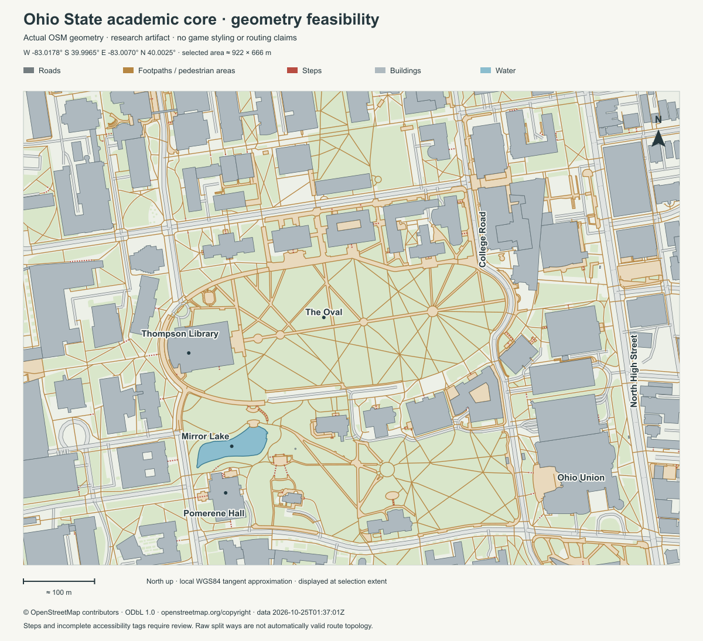

# OSU academic core: bounded data feasibility check

**Result: feasible for a geographically grounded visual prototype. Not yet a validated public, accessible, or multimodal routing model.**

One request to the public [Overpass interpreter](https://overpass-api.de/api/interpreter) returned the selected OpenStreetMap features. No cloud service, account credentials, live tracking, proprietary map imagery, or private/person-level data was used. The request and response limits were deliberately bounded; the saved files run offline. [Overpass’s public-service guidance](https://dev.overpass-api.de/overpass-doc/en/preface/commons.html) supports modest queries and warns against treating its public instances as an application backend.

Research completed October 24, 2026 in America/New_York. Retrieval was `2026-10-25T01:38:04Z`; the Overpass base timestamp was `2026-10-25T01:37:01Z`. These timestamps describe the extract/database state, not the last survey date of every feature.

## Files

| File | Purpose |
|---|---|
| [osu-core.geojson](osu-core.geojson) | 1,225,096-byte sanitized geographic snapshot; 2,496 features |
| [query.overpassql](query.overpassql) | Exact reproducible spatial/tag selection; not run by the application |
| [manifest.json](manifest.json) | Endpoint, timestamps, hashes, extent, tag counts, conversion policy, attribution |
| [diagnostics.json](diagnostics.json) | Basic geometry checks, shared-node connectivity, and projection details |
| [osu-core-research.svg](osu-core-research.svg) / [PNG](osu-core-research.png) | Map rendered from the actual saved GeoJSON, not generated game art |
| [inspect_snapshot.py](inspect_snapshot.py) | Offline diagnostics and SVG reproduction; standard-library Python; no network calls |
| [LICENSE.md](LICENSE.md) | Dataset license and map attribution |

## Exact extent and coordinate handling

The selection box in longitude/latitude is **west −83.0178, south 39.9965, east −83.0070, north 40.0025**. It includes the Oval, Thompson Library, Mirror Lake, Ohio Union, College Road, and High Street. Its approximate dimensions are **922 × 666 metres**, about **0.61 km²**. This is smaller than the full campus scene proposed in the geography memo; it intentionally excludes the stadium and river corridor.

GeoJSON coordinates retain **WGS84 longitude, latitude (OGC:CRS84 order)**. No latitude/longitude-as-metres conversion is implied. The research diagram uses a local tangent/equirectangular approximation about `(−83.0124, 39.9995)`, with WGS84 prime-vertical/meridional radii. Its north arrow follows increasing latitude; the 100 m bar is derived from that transform and marked approximate. The script records the factors in `diagnostics.json`. A simulation should choose and test a proper local metric projection before measuring walking speed or hazard distance.

**The snapshot preserves complete selected ways rather than clipping them.** Some way vertices therefore extend outside the query rectangle: the actual feature-coordinate bounds are approximately `[-83.0207652, 39.9953242, -82.9958359, 40.0038347]`. The diagram clips to the selection rectangle. A loader must not mistake the expanded raw extent for the proposed playable area. Boundary crossings need intentional portals or a network buffer, not arbitrary broken road ends.

## What is actually populated

| Observation from this extract | Count / evidence | Implication |
|---|---|---|
| Geographic features | 311 points, 1,240 line strings, 945 polygons | Rich enough to reproduce the visible campus structure |
| Building features | 117; 54 tagged university, 6 parking, 3 dormitory; other types include commercial, house, apartment and construction | There are useful footprints, but a footprint is not evidence of public access or current occupancy |
| Building attributes | 80 named; 56 with `building:levels`; 8 with `height` | Recognizable anchors are present; precise heights cannot be filled in as factual where missing |
| Highway-tagged features | 1,369, including area geometry | Counts are OSM feature/way counts, not distinct streets or independent route edges |
| Pedestrian detail | 946 footway features, 144 pedestrian features, 100 steps features | Organic path layout and stairs exist; do not flatten all of them into identical walkable streets |
| Road detail | 40 unclassified, 17 primary, 7 residential, 108 service features, plus other types | A separate vehicle layer is plausible after permission/default/turn rules are resolved |
| Connectivity hints | 51 highway features tagged one-way; 45 maxspeed; 56 lanes; 702 surface | Partial useful attributes, not a complete road model |
| Crossings and entrances | 94 crossing points; 205 entrance points; 12 bus-stop points | Transfer/crossing candidates exist, but stop timetables and permissions are not established |
| Explicit highway permission/accessibility tags | 14 general `access`; 16 `foot`; 9 `motor_vehicle`; 2 `wheelchair`; 42 `incline` | Absence of a tag cannot be read as confirmed permission, accessibility, level grade, or current safety |

These are observed metadata counts, not completeness estimates. Some sidewalks are mapped separately, so sparse `sidewalk` tags on road centerlines do not establish that sidewalks are absent. Some paths have both area and centerline representations, so rendering/route conversion must deduplicate their purpose without destroying geometry.

Verified named anchors in the saved data:

- [The Oval](https://www.openstreetmap.org/way/552383147): polygon `way/552383147`.
- [William Oxley Thompson Memorial Library](https://www.openstreetmap.org/way/30172308): building polygon `way/30172308`.
- [Mirror Lake](https://www.openstreetmap.org/way/30172049): water polygon `way/30172049`.
- [Ohio Union](https://www.openstreetmap.org/way/154204619): building polygon `way/154204619`.
- [Pomerene Hall](https://www.openstreetmap.org/way/154204627): building polygon `way/154204627`.

The research diagram labels only these named anchors and the named College Road/High Street geometries present in the snapshot.

## Checks performed and important gaps

The six returned multipolygon relations assembled without unresolved rings. All saved feature IDs are unique. Basic checks found no non-finite/out-of-range coordinates or open/undersized polygon rings. **These checks do not establish self-intersection validity, overlap correctness, completeness, or a routable graph.**

For a deliberately minimal diagnostic, linking consecutive node IDs from the 1,240 linear highway features yields 4,070 nodes in 20 components; the largest has 3,990 nodes. Of the 205 mapped entrance nodes, 191 share an ID with one of those linear highway geometries. This ignores all access and mode restrictions and is not a routing result. Shared-node connectivity alone says nothing about legal turns, wheelchair passage, gated access, sidewalk crossings, or an entrance being usable at a particular time.

Remaining work before honest simulation:

1. Resolve walking, bicycle, and motor-vehicle access using OSM tag semantics and applicable defaults. Explicit restrictions are present; building and road geometry must not automatically become public movement space.
2. Preserve bridge/tunnel/layer separation, split ways at valid junctions, treat pedestrian areas appropriately, and handle turn restrictions. This targeted query does **not** fetch turn-restriction relations or transit route relations.
3. Review stairs, slopes, curb transitions, and entrance access. The sparse wheelchair tags cannot support an “accessible route” claim.
4. Supply independent, dated transit routes/calendars and parking behavior. Bus-stop points do not contain a complete operating schedule or vehicle capacity model.
5. Validate named anchors and representative public routes against official OSU wayfinding. Current construction/temporary closures require a separate, dated scenario configuration.
6. Obtain suitable elevation and weather inputs for hazard modeling. Grass/water/building geometry alone does not predict flooding, wind, shelter effectiveness, or emergency response.
7. Use synthetic population and activity assumptions with declared scope; this map contains no measured occupancy, household membership, actual student timetable, individual route history, or reaction ground truth.

An educational prototype can use the footprint and landscape geometry now, with clear assumptions. Calling it the most accurate possible campus emergency simulation would require much more validation than this feasibility check supplies.

## Source and privacy handling

Saved properties are a whitelist of public map geometry, building type/name, and circulation/access attributes. Addresses, phone/email/contact data, account/editor identifiers, contributor histories, and unrelated tags were omitted. OSM feature/node IDs remain because they support provenance and shared-node diagnostics. Names are public mapped place/building names, not a population roster. The full server response was hashed but was not saved.

Attribution: **© OpenStreetMap contributors** — [copyright and ODbL information](https://www.openstreetmap.org/copyright). The derived geographic snapshot remains subject to [ODbL 1.0](https://opendatacommons.org/licenses/odbl/1-0/). No official OSU or transit-provider endorsement is implied.
