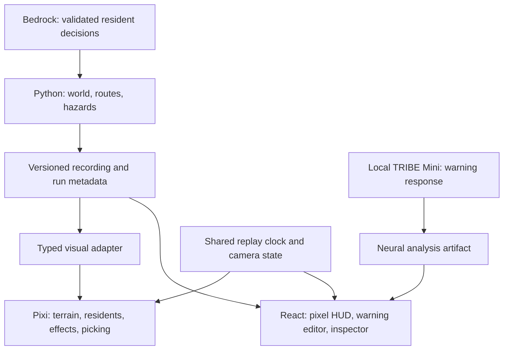

# Last Warning: a living pixel world

Research and implementation plan · 24 October 2026

**Recommendation:** build an original WorldBox-inspired, top-down pixel city with **PixiJS + TypeScript inside the existing React application**. Keep the Python simulation, Bedrock residents, local TRIBE Mini, saved runs, and spending controls. Replace the visual world and the whole interface together.

This document is a plan. The working simulator has not been replaced, packages have not been installed, and this research made no paid model calls. The companion memos contain the source research: [visual reference](research/worldbox-art-direction.md), [renderer decision](research/worldbox-rendering.md), and [assets, skills, and tools](research/worldbox-assets-and-skills.md).

Implementation began after the user approved this plan. An [editable Figma layout board](https://www.figma.com/design/EqiIDG8pWRpvfssksCYEA9?node-id=2-10) records the proposed hierarchy with native text/controls and editable vector city art. It is a planning reference, not a claim that its illustrative residents are real run output.

## 1. What the finished experience should be

**Visual thesis:** a detailed, inhabited river town, built from crisp pixel art, with small readable residents and a compact game interface; a place the viewer cares about before a disaster arrives.

**Content plan:** the world occupies the viewport. A restrained status bar shows the scenario, time, and essential outcomes. A bottom toolbelt controls disasters, warnings, comparison, and replay. Selecting something opens its context panel. Settings, saved experiments, and neural results remain inside the same workspace.

**Interaction thesis:** zoom from town to person; select and follow a resident; watch a recorded warning change decisions and movement; rewind or compare the same starting population. Movement and effects share the replay clock. Panels open quickly and preserve the camera and selection.

The goal is the feeling of a living simulation, with Last Warning's own modern town and emergency response identity. WorldBox's official material establishes the useful reference: observing settlements and inhabitants while applying localized world events. Its source code, internal engine, sprites, and exact asset pipeline are not established by that material. We should borrow its visual grammar and interaction hierarchy, then author our own art. [Official WorldBox overview](https://www.superworldbox.com/).

### The first screen

- Start over an attractive, readable neighborhood: a bridge, a recognizable shelter, clustered homes, trees, and residents already visible. The initial camera is composed, rather than an arbitrarily distant map fit.
- Use a full-viewport world with a small **Last Warning** identity and short, useful controls. Remove prototype footer copy, terminal commands, redundant status badges, empty “ready” labels, and explanatory text that does not help operate the simulation.
- Keep one obvious action: **Run warning**. Disaster selection and warning editing are directly reachable from the toolbelt. Running and comparing retain the same workspace.
- Use an authored pixel frame system throughout: menus, dropdowns, warning editor, inspector, saved runs, loading, errors, tooltips, charts, and neural results. A pixel world surrounded by an unrelated dashboard is an incomplete redesign.

See the [workspace layout blueprint](research/worldbox-workspace-blueprint.png) ([editable SVG](research/worldbox-workspace-blueprint.svg)). It is a proposed layout, not an implemented screen or real simulation result.

## 2. The city needs art direction, not just square pixels

### Terrain and buildings

Use layered, top-down tiles with consistent light direction and ground contact. Begin with a shared palette of roughly **24–32 opaque colors**, plus transparency. Reserve strong warning colors for hazards and selection; ordinary roofs, vegetation, and streets should be quieter.

Create recognizable districts through roof material, building silhouettes, vegetation, and street furniture. The first art set should include homes, shops, a school or civic building, a bridge, and an unmistakable shelter. Their initial role is visual identity; a school illustration does not introduce a school evacuation mechanic.

Ground detail should follow a hierarchy: large readable land/water/street shapes first, then roof and tree silhouettes, then small props. Use shoreline transitions, a few water animation bands, cast shadows, fences, lamps, benches, and controlled ground variation. Avoid uniform building repetition, scattered random decoration, unrelated asset packs, and full-screen postprocessing that softens the pixels.

The existing physical map has a straight river and orthogonal streets. The first release must draw those real structures faithfully. A more organic river town belongs to the versioned world upgrade in section 7; painting a different river over the existing flood model would make the demo misleading.

### Art scale and zoom

The simulation uses **40 × 40 logic cells**. Art resolution is independent of that grid. Test two scales in the first slice:

1. **Simple:** one 16-pixel art tile per logic cell, a 640-pixel source world.
2. **More detailed:** four 16-pixel tiles along each logic-cell edge, a 160 × 160 visual grid, **25,600 tiles** and a 2,560-pixel source world. This supports narrow street drawings, sidewalks, yards, and multi-tile buildings while keeping the same logic cells.

Choose the scale after viewing a crowded bridge and a neighborhood at the real screen size. More source pixels alone do not make better art. Do not begin with 16 × 16 visual subdivisions per logic cell: that would mean 409,600 visual tiles before any residents or effects.

Use nearest texture sampling, snapped camera positions, and deliberate detail zoom levels. A whole-world fit may need a separate overview representation; arbitrary browser sizes and fractional zoom cannot all preserve evenly sized physical pixels. Test DPR 1, 2, and 3. [Pixi texture controls](https://pixijs.download/release/docs/rendering.TextureStyle.html).

### Residents as people

Every simulated resident gets a persistent appearance derived from its ID and the run's appearance seed: body silhouette, clothing palette, and a small number of accessories. The same resident looks the same in both warning variants. All 300 residents remain represented; they are not replaced by decorative crowds.

- Four facing directions and short walking loops. Animate walking only during actual movement; keep a stable foot anchor and idle pose.
- Show `WAIT`, `PREPARE`, `SHARE`, and `EVACUATE` through restrained poses or short icons when those decisions are recorded. A share signal must correspond to a real recorded share event, rather than ambient speech bubbles.
- Make selection easy through a larger invisible hit area, a ground ring, and a way to cycle through overlapping people. Outline or fade occluding roofs for the selected resident.
- A resident inspector shows ID, current state, exposure, actual recorded action, its brief model-supplied reason, and time. Add route/goal and other initial traits only after exposing their real recorded values through the API.
- Display exposure as exposure. The present model does not establish deaths, injuries, rescue, or family relationships; do not invent those outcomes with corpses, ambulances, or emotional dialogue.

There is a movement correctness issue to resolve: a resident can cross several road edges between saved frames. A straight tween between frame endpoints can cross a building corner. Record optional path segments and substep timing for new runs; preserve existing recordings and snap an ambiguous legacy transition rather than inventing a route.

## 3. Disasters should transform the same world

| Disaster | Proposed art and motion | Required connection to recorded state |
| --- | --- | --- |
| Flood | Layered blue water, animated edges, bridge contrast, submerged ground details, restrained ripples | Water footprint follows the actual flooded cells; road closure markers follow actual closures. |
| Wildfire | Small bright cores, staggered flame loops, rising smoke, darkened ground and persistent soot | Flames follow currently active cells; aftermath follows affected cells. Smoke is cosmetic and does not imply a modeled visibility penalty. |
| Tornado | A readable rotating column, a ground shadow, bounded debris, a visible trail | Position, start/end, radius, and affected trail follow recorded hazard metadata. Debris does not create unrecorded blocked roads. |

Differentiate active danger from lasting affected terrain. A cell that is no longer burning can remain visibly scorched. Avoid overwhelming residents with opaque particles or making a beautiful effect that covers the important routes.

Accurate flood depth or water-height submersion needs additional exported per-cell data; the current cell footprint alone cannot establish depth. Surface animation can be cosmetic without claiming a measured water height. Likewise, scorched ground is a footprint visualization; a destroyed building needs an actual building-damage model.

All effects are deterministic for a run and playback time. Pause freezes water, walking, smoke, and tornado motion; seeking reconstructs the right state. Reduced motion provides a quieter representation. Atmospheric tint, parked vehicles, and small ambient movement can be presentation details; changing weather, traffic, structural collapse, rescue, or rebuilding require real mechanics before their consequences appear.

Add restrained sound after the visual language works: a quiet river/wind bed, subtle tool clicks, localized fire/tornado texture, and a brief alert cue at the recorded warning time. Use a small native Web Audio mix with separate ambience/effects volume, a persistent mute control, and user-initiated audio activation. Pause should quiet the world; scrubbing should not repeatedly trigger warning sounds. Original or verified CC0 clips get the same provenance treatment as sprites. [Web Audio best practices](https://developer.mozilla.org/en-US/docs/Web/API/Web_Audio_API/Best_practices).

## 4. The whole website becomes a game workspace

| Surface | Proposed behavior |
| --- | --- |
| Top HUD | World/scenario name, elapsed simulation time, population, sheltered, exposed; compact enough to leave the city dominant. Detailed metrics are contextual. |
| Bottom toolbelt | Original pixel icons for Flood, Fire, Tornado, Warning, Compare, Runs, and Advanced. Each has a clear selected state, tooltip, and keyboard access. |
| Warning panel | One in-world panel for editing warning text and channels, selecting the scenario, and running it. Results return to the same world. |
| Resident inspector | Opens only on selection, with portrait, true state and last recorded action. Follow and route controls appear only when supported. |
| Replay strip | Play/pause, speed, scrubber, current time, reset view. The camera remains usable while paused. |
| Compare mode | Two synchronized views inside the same canvas/workspace, with matching camera and clock. Clearly label warning A/B and preserve the same resident identity. |
| Neural results | A compact research panel within the world UI, showing real Mini provenance, warning text, response series and comparison. Pixel framing around a clear, readable chart. |
| Advanced | Scenario parameters, behavior provider and budget, assumptions, artifacts, developer details. The default view stays focused on operating the world. |
| Small screens | Fewer visible toolbelt controls, contextual bottom sheets, a collapsible inspector, and a camera that can pan. No tiny desktop HUD squeezed into a phone. |

The disaster tool can preview and place the **next run's origin** on a legal map cell, updating the real scenario configuration. Saved replay stays an inspection of its recorded events. Dropping another disaster into an already-running simulation, painting terrain, or spawning residents is a separate intervention/editor feature: it needs authoritative backend events, a branched run history, budget handling, and new comparison semantics. The first release should make this distinction clear without presenting inactive god-power buttons.

Use **semantic React/HTML controls styled with pixel frames and icons** above the canvas. This can look fully like a game while retaining text selection, keyboard focus, forms, and screen-reader labels. Do not put every form and paragraph into WebGL. Use a small pixel display face for short headings and a readable local body font for explanations and numbers; validate font licensing before bundling.

Target 44-CSS-pixel touch areas around small icons, visible focus, shape plus color for states, and readable 14–16-pixel body text. These are project targets; WCAG's minimum target criterion is 24 CSS pixels with exceptions. [W3C target-size guidance](https://www.w3.org/WAI/WCAG22/Understanding/target-size-minimum).

Pixel styling must include the awkward states too: loading, expired AWS credentials, malformed model output, insufficient budget, empty history, long warning text, missing Mini analysis, and a selected resident obscured by a building. These should be concise, actionable, and visually consistent.

## 5. Recommended stack

| Layer | Choice | Why |
| --- | --- | --- |
| World renderer | **PixiJS 8**, WebGL initially | Sprite/tile rendering without introducing another simulation engine. Pixi recommends its stable WebGL renderer for production; WebGPU needs separate validation. [Renderer guidance](https://pixijs.com/8.x/guides/components/renderers). |
| Application | Existing React 19 + TypeScript + Vite | Keep warning workflows, API types, accessibility, and saved results. Use `@pixi/react` for lifecycle/scene boundaries, imperative pooled sprite updates for animation. [React integration](https://react.pixijs.io/getting-started/). |
| Terrain | `@pixi/tilemap`, subject to a compatibility spike | Batch tile geometry; compare with cached static chunks before committing to a more complex renderer. [Official package repository](https://github.com/pixijs-userland/tilemap). |
| Backend | Existing Python/FastAPI/Mesa/NetworkX | Owns authoritative movement, hazards, routes, decisions, storage, and comparisons. |
| Resident intelligence | Existing AWS Bedrock Nova Micro | Actual LLM decisions at bounded decision rounds. Camera movement, sprite animation and replay never trigger model calls. |
| Neural analysis | Existing local official TRIBE v2 Mini | Separate warning-reading response; preserve model provenance and real predictions. This is not a per-resident mind-reading or emotion model. |
| Art and maps | Pixelorama + Tiled → PNG/JSON | Free, editable source assets and a straightforward export pipeline. |
| Verification | Existing Python tests + Playwright + real-browser profiling | Data parity, workflows, visual regression, accessibility, and performance. |

**Why not a different language or engine?** Phaser 4 is a credible alternative if this grows into a separate game with many gameplay scenes and systems; it adds lifecycle machinery we do not currently need. Godot is good for a standalone game, but its web export and React bridge would add a substantial migration. Its web exporter uses WebAssembly/WebGL 2, with platform constraints. Keeping Three and adding a pixel filter changes the image resolution, but does not supply the authored silhouettes and tile art being requested. Rust/WASM is unnecessary unless profiling finds a problem that cannot be solved in the current architecture. [Phaser releases](https://phaser.io/download/archive), [Godot web export](https://docs.godotengine.org/en/stable/tutorials/export/exporting_for_web.html), [Three pixel pass](https://threejs.org/docs/pages/RenderPixelatedPass.html).

Pin and test a compatible package set before the renderer migration. Exact research-snapshot versions and integration cautions are in the [technical memo](research/worldbox-rendering.md).

The resident architecture remains application-managed: FastAPI/Mesa maintains each person's persistent state; the backend batches individual contexts through Bedrock Converse at the four recorded decision rounds, validates each returned action, and applies it to that resident. Python executes routing and physical movement between rounds. This makes hundreds of visible inhabitants affordable while retaining inspectable LLM choices. Recordings provide decisions, reasons, and provenance for replay; the pixel renderer consumes those records.

### Runtime structure

Use **one renderer, one canvas, shared texture atlases**, and two clipped scene roots for comparison. Pool resident sprites and effects; do not update 600 residents through per-frame React state. Y-sort feet where necessary, split tall roofs/foliage, update dirty hazard chunks, and avoid expensive full-screen filters. Culling is a measured optimization, not a guaranteed speed improvement. [Pixi performance guidance](https://pixijs.com/8.x/guides/concepts/performance-tips).

Proposed modules under `frontend/src/pixel-world/`: `PixelWorld`, `CityVisualAdapter`, `PixelCamera`, `ResidentLayer`, `HazardLayer`, `SelectionController`, and `ReplayClock`. Version exported art under `frontend/public/art/last-warning/`; keep editable sources outside the runtime bundle. Retain the current `CityMap` selection/data interface where practical. Keep the existing renderer as a temporary rollback path during verification, then remove it after parity passes.

## 6. Tools, skills, plugins, and the art pipeline

### Production tools

- **Pixelorama:** free/open-source default for palettes, animation, and sprite sheets. **Aseprite** can replace it if already owned; its CLI supports repeatable PNG/JSON export. There is no required art-tool purchase. [Pixelorama](https://pixelorama.org/), [Aseprite CLI](https://www.aseprite.org/docs/cli/).
- **Tiled:** author tileset tests and decorative layers against the existing map; later author the canonical world layers. Use its terrain rules for coherent transitions. LDtk is a reasonable alternative, but do not maintain two map importers. [Tiled terrain rules](https://doc.mapeditor.org/en/stable/manual/terrain/), [LDtk](https://ldtk.io/).
- **PNG/JSON grid sheets first:** explicit frame sizes, anchors, durations, and padding. Add an atlas packer only if measured waste justifies it. No paid packer or trial-only build dependency is needed.
- **Kenney Tiny Town:** optional CC0 foundation, 130 assets in a 16×16 style. Extend/repaint one coherent source into the project's palette; author missing residents, emergency landmarks, disasters, and UI. Do not mix several incompatible packs. [Source and license](https://kenney.nl/assets/tiny-town).

Every asset needs provenance, license, editable source, palette version, atlas rectangle, logical footprint, foot anchor, animation timing, and export checksum. Start with a small playable slice, then approximately **243 modular source frames** across terrain/roads, buildings, props, residents, hazards, and UI icons. This is an initial world/icon inventory, not 243 independent image-generation prompts or a complete count of the HUD artwork. Budget panel/frame states, cursor art, typography and audio separately during the slice. The detailed count and licensing checks are in the [asset memo](research/worldbox-assets-and-skills.md).

### Skills worth applying

The research agents read the actual upstream instructions and relevant references, rather than selecting by names alone:

| Skill | Role |
| --- | --- |
| Existing local `frontend-skill` | Art brief, world-first composition, disciplined hierarchy, utility copy. |
| [Anthropic frontend-design](https://github.com/anthropics/skills/blob/main/skills/frontend-design/SKILL.md) | A deliberate visual identity and coherent interface, adapted to this game's brief. |
| [OpenAI sprite-pipeline](https://github.com/openai/plugins/blob/main/plugins/game-studio/skills/sprite-pipeline/SKILL.md) | Shared sprite scale, frame normalization, foot anchors, in-game previews. Low observed adoption; useful workflow, not a promise of finished art. |
| [Vercel web-design-guidelines](https://github.com/vercel-labs/agent-skills/blob/main/skills/web-design-guidelines/SKILL.md) | Keyboard, focus, forms, reduced motion, and interaction review. |
| [Community pixel-art-sprites](https://github.com/omer-metin/skills-for-antigravity/blob/main/skills/pixel-art-sprites/SKILL.md) | Secondary checklist for palette, silhouette, animation and atlas errors; verify technical advice against renderer documentation. |
| Existing local Playwright skill | Capture and test the actual simulator across workflows and viewport sizes. |

No external skill was installed during research. AI image generation can help explore a mood or create a seed sprite, but independent generated frames often drift in anatomy, palette, and scale. Finished assets still require normalization and in-engine review.

**Plugins:** Figma was surfaced as a relevant optional design plugin and suggested in the app; its tools subsequently became available in this session. It could help maintain an editable HUD/component board, with authentication and document access verified on first use. It is not required for implementation. The focused plugin search did not surface a dedicated Aseprite/Tiled connector. A website-builder plugin does not solve this custom simulation renderer. Native research subagents already split the visual, renderer, and asset investigations; Kiro Crew is optional, not a dependency or an additional runtime service.

## 7. Two releases, with honest scope

### Release A: the complete pixel presentation

Preserve the current simulation and all real results. Deliver the authored city, real animated residents, three hazards, complete pixel HUD, warning workflow, resident selection, history, neural panel, and synchronized comparison. Use stored real runs throughout visual development, so iteration needs no Bedrock inference.

Add backward-compatible recording fields where needed: `art_seed`, `art_manifest_version`, optional `agent_motion` segments, and read-only resident detail. Legacy recordings remain readable and retain their metrics and initial-condition hashes. Do not rerun old experiments simply to populate decorative fields.

Long Bedrock runs also need a real progress experience. Add background run jobs with a run ID and a polling/SSE status API, reporting actual stage/decision-round/batch completion. Keep the world responsive while computation runs. Only expose a completed, fully validated decision round; do not fabricate progress percentages or change the existing all-residents validation rule. Neural inference has a separate stage and clock.

Make job creation idempotent so a double click or reconnect does not start a second paid run. Carry the existing atomic budget reservations through workers and retries. Cancellation stops future requests; it cannot undo a request already sent or its accounted charge.

### Release B: the deeper living town

If the target includes natural curves, more convincing urban blocks, and daily life, create a **versioned canonical world definition** shared by Python and the renderer. Export semantic Tiled layers/objects into validated JSON: water, elevation, roads, walkable cells, bridges, building footprints, shelter locations, districts, and wildfire fuel where modeled. Decoration lives separately.

The backend builds route graphs and hazards from that same definition. Map changes get a new world/simulation version and new comparison baselines; an attractive map must not invalidate the experiment silently. Validate bridge connectivity, reachable shelters, legal spawn positions, terrain membership, and deterministic seeds before accepting a world.

Home/work/leisure walking, destinations inside buildings, households, moving cars, shelter capacities, rescues, injuries, and rebuilding are separate mechanics. Introduce them only with actual state, decisions, routing, and recorded outcomes. A complete visual release does not require implementing all of these. Prioritize home-to-shelter movement and plausible pedestrian paths before adding more disasters or fantasy powers.

No destructive data migration is proposed. New fields are additive, old recordings remain immutable, and old worlds remain replayable. A schema change would be reviewed and applied separately when implemented.

## 8. Build sequence and review gates

These are **rough engineering effort estimates**, not a calendar commitment; art iteration is the critical path. Several tasks can overlap, but overlapping work does not remove review.

| Stage | Deliverable | Estimate | Gate before continuing |
| --- | --- | --- | --- |
| 1. Art-complete vertical slice | One bridge, four buildings, six props, a walking/selectable resident, three hazard samples, and a working pixel HUD | 2–3 person-days | Looks coherent at normal zoom, not only as enlarged sprites. Pixel scale and palette chosen here. |
| 2. Renderer and replay | Atlas loader, camera, visual adapter, real resident layers, picking, correct replay paths | 2–3 | Stored agent IDs/cells, hazards, closures, timing and selection match the source recording. |
| 3. Whole city and effects | Full terrain/building set, variation, occlusion, complete resident poses, real disaster footprints | 3–4 | Crowded 300-resident scenes remain readable; no inconsistent anchors or false outcomes. |
| 4. Complete game workspace | All HUD states, warning editor, inspector, saved runs, Mini panel, actual job progress | 3–4 | Both warnings run/replay through one workspace; loading and failure recovery work. |
| 5. Comparison and final polish | One-canvas paired view, performance, browser/device checks, accessibility and regression fixes | 2–3 | Correct 300+300 comparison, release gates below, no leftover dashboard/prototype chrome. |
| **Release A total** | **A cohesive pixel-art product over the real model** | **12–17 person-days** | Art, behavior, and interaction pass together. |
| 6. Versioned living-world upgrade | Organic canonical map and prioritized movement/world mechanics | **+5–10**, depending on mechanics | New deterministic baselines and map/route validation; every visible behavior backed by real state. |

Parallel ownership during implementation: one agent owns renderer/camera, one owns assets and map import, one owns HUD and interaction; the lead owns recording/API boundaries, model integrity, integration, and review. Avoid simultaneous edits to the same scene root or app shell. Review the vertical slice before scaling production.

### Release checks

- **Visual:** coherent silhouettes and palette, legible bridge/shelter/resident at three zoom levels, crisp detail modes, no atlas bleeding, correct roof overlap, useful focus states, and every UI surface following the same art direction.
- **Correctness:** existing backend tests remain green; stored run metrics and comparison hashes are unchanged by rendering; new path/world/asset checks cover meaningful contracts. Real Mini provenance remains intact. All three disasters and both warning variants work end to end.
- **Desktop target:** on the M4 Mac in Chrome and Safari at 1440×900, mean at least 55 FPS for one world and 50 FPS for paired worlds; p95 frame interval at most 25 ms. These are proposed targets, not achieved measurements.
- **Mobile target:** on actual mobile Safari and a midrange Android device, mean at least 30 FPS, with a disclosed lower-effects tier if necessary. Browser viewport emulation is layout evidence, not mobile GPU evidence.
- **Method:** warm up, measure 60 seconds three times across disasters/zoom/comparison, include a five-minute mobile soak, verify fast picking, context recovery, stable memory across repeated opens, and no continued ambient ticker while paused. See the technical memo for the full protocol and texture budgets.
- **Cost:** reuse saved real runs for art and performance work. Keep the existing $0.30/run, $5 Bedrock phase, and $30 project request ceilings. These are application safeguards, not a verified AWS account billing balance. No cloud GPU, permanent endpoint, or paid art software is required for this plan.

## 9. The decision that matters most

The first implementation deliverable should be a **small, art-complete, genuinely playable slice**, using a stored real recording. It must establish the town's identity, a believable resident, a readable disaster, and the finished interface material together. Expanding a weak slice into a large map would create more work without improving the result.

The strongest differentiator is a world that is beautiful enough to explore and truthful enough to inspect: click a tiny person, see the real Bedrock action and its recorded reason, follow the actual route, and compare how a different warning changes the same population—with the real local Mini response available in the same game workspace.
